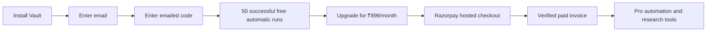
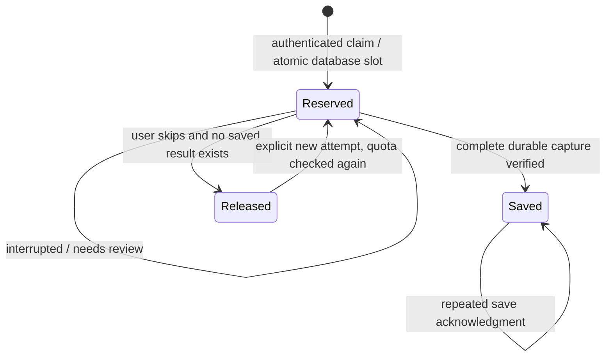
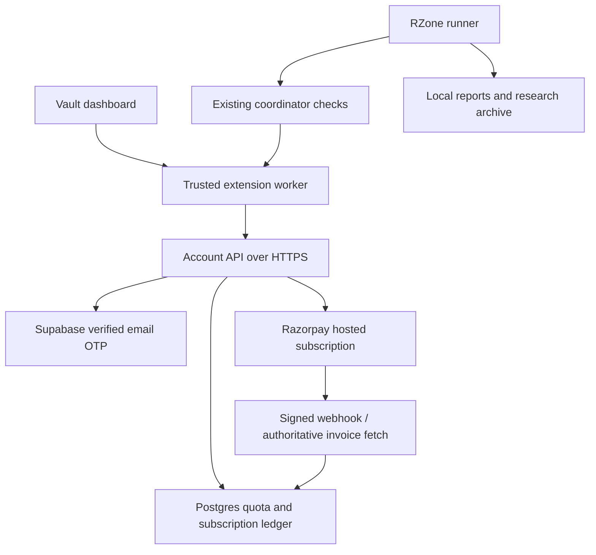

# Account access and ₹899/month Pro — v0.21.0 candidate

This is the implementation candidate for a public launch. It is not connected to live email delivery, checkout or an account deployment yet. The installed v0.19.0 extension remains the accepted RZone build. Do not replace it with this unconfigured candidate.

## The customer journey

No password or manual licence file is needed in the account edition. The email account owns the lifetime allowance across installation resets and devices. Research archives remain local and are neither uploaded nor automatically synchronised. Signing into a second device restores entitlement, not the first device's research library; use backup/import for that.

| Feature | Community | Pro |
|---|---|---|
| Automatic real trials | 50 successfully saved trials, once per verified account | Continued automation; no Vault subscription run quota |
| Strategy inputs, ranges and chart types | Included | Included |
| Read history and basic comparisons | Included | Included |
| Existing backup, restore and exports | Included | Included |
| Reuse history to make a new study or validation stage | Pro | Included |
| Reusable research plans, sensitivity maps and detailed reports | Pro | Included |

The existing bounds of 500 trials per batch and source-supported combinations still apply to Pro. They are execution safeguards, not a monthly usage allowance. Every combination is one trial. Existing historical records/imports and manual captures do not retroactively consume the free allowance. The counter starts with account-enabled automatic trials.

## Run accounting

Starting checks the whole queued batch against the available allowance. Every claim reserves one slot transactionally, preventing two devices from spending the 50th slot. An unfinished reservation is not a charged successful run, but it holds availability until reviewed. Check saved result counts its verified capture once; Skip releases an unsaved reservation. There is no automatic replay of uncertain source submissions.

Reservations use the actual immutable trial/run ID. The worker persists only non-secret receipt metadata locally. On save, the coordinator verifies the existing complete report, source evidence and exact settings before settlement. A settlement/network failure keeps the result and requires review; it does not submit the next trial. Repeated settlement is idempotent. Changing account cannot settle another account's locally started trial.

If uninstalling loses the local study journal, Your Vault account → Recover unfinished runs lists that account's pending IDs. The user must stop tests on all devices and confirm that the result cannot be recovered before releasing a missing study's slot. A run or study still in the current library cannot be released through this shortcut; use My studies to check the saved result or skip it. Successful, already-counted runs cannot be released.

## Services and boundaries

- Email login uses Supabase email OTP, with the email template showing `{{ .Token }}`. The API verifies the user's current provider session and confirmed email on every authenticated request. No caller-supplied user ID selects an account.
- Access and refresh tokens live in `chrome.storage.session`, whose default access is restricted to trusted extension contexts. Session survives a worker restart but ends on a full browser restart; the user signs in again. Tokens are not written to local research storage, backups, URL parameters or logs.
- The RZone content script cannot call account commands. Only the installed dashboard's exact same-extension origin is authorised by the worker.
- Database tables enable RLS, with no anonymous/authenticated table access. Service-only RPCs lock each account row before reserve/settle. Service credentials stay in host secret settings, never the extension.
- Billing is fixed at INR 89,900 paise monthly, quantity one. A mismatching Razorpay plan cannot create checkout. A linked checkout is reused; an uncertain create retains an operator-review reservation instead of creating another charge.
- A signed webhook triggers a provider fetch; browser success text and event payload claims never grant Pro. Paid invoice and captured payment verification establish paid-through dates. Duplicate events and older concurrent reads cannot double-charge or overwrite a newer entitlement snapshot. Refunds remove unfunded periods when billing is refreshed.
- Cancel renewal requests cancellation at the cycle end; paid-through access remains through the funded period. Server time controls expiry. Expired users regain any unused Community runs and keep all locally saved work readable/exportable.
- No account system makes the old MIT releases or modified client forks a tamper-proof paid product. This implementation enforces the official service and unmodified extension path; previous public releases remain available.

## Owner deployment checklist

The staging Docker blueprint, read-only provider checker and Store reviewer checklist are prepared in [Launch operations](LAUNCH-OPERATIONS.md). The candidate uses independent **Backtest Vault** branding and includes the four packaged icon sizes. A separately published owner-private launch website presents the planned pricing and draft policies; it does not enable payment or public signup.

1. Create a Supabase project in your ownership. Configure production SMTP, the email OTP template, provider rate limits and an appropriate session policy. Run `server/schema.sql` in its SQL editor. The migration is repeatable. The application never uploads strategy data.
2. Create and verify your Razorpay merchant account and enable subscriptions. Create a **monthly / interval 1 / INR / amount 89900** plan. Configure your customer support contact, invoicing, cancellation and refund policy for the public listing.
3. Deploy the `server/` Dockerfile on a host with managed HTTPS. Add the settings shown in `server/.env.example` through the host's secret controls. Production refuses Razorpay test keys. `ALLOWED_ORIGINS` must contain the exact Store extension origin; add the existing unpacked ID only for an explicitly authorised migration test. Keep provider secrets out of chats and repository files.
4. Put the account API behind the host's abuse controls. The app has bounded bodies and per-user/email/process request limits; production SMTP/provider and edge limits must cover restarts and multiple instances. Never expose a direct unrestricted proxy to email sending.
5. Configure Razorpay's webhook endpoint as `https://YOUR_API/billing/webhook`, use a separate strong webhook secret, and enable subscription and refund/payment events. Payment-only refund notifications resolve the payment's invoice to its subscription before reconciling funded access. Review disputes operationally under the published refund policy; a dispute event alone does not automatically revoke a captured payment. Set up alerts for failed webhook delivery and unresolved checkout reservations.
6. Run `node scripts/configure-accounts.cjs --origin https://YOUR_API`. This writes only the public origin and narrows the manifest's host permission and `connect-src` to that one HTTPS service. Content-script origins remain unchanged. No remote payment JavaScript is loaded into the extension; payment opens a hosted tab.
7. Before publication, verify real email delivery, a Razorpay test subscription, duplicate webhook delivery, renewal failure, cancellation, refund and reinstall login against the deployed project. Then activate live keys and complete Store review instructions. Neither fixture tests nor local installation tests establish live payment acceptance.
8. Publish the complete Windows/Linux ZIP and Store package after required application and extracted-package checks. The client needs no developer runtime. The Node server is hosted by the publisher, not installed by customers. Existing unpacked users back up/import into the Store identity and verify their archives before removing the old installation.

An uncertain checkout is resolved by searching Razorpay subscriptions for `notes.vault_checkout_request`, verifying its `vault_user_id` and fixed plan, then linking that exact subscription through `vault_attach_checkout`. Clear the reservation only after confirming no subscription was created. This avoids accidental duplicate subscriptions after an API timeout.

## Validation scope

`npm run test:accounts` executes the actual SQL migration and RPCs in embedded PostgreSQL, checks anonymous permission rejection, exercises the account HTTP endpoints through mocked provider responses, and tests the extension's actual account client and coordinator hooks. It covers the 50th-slot race, restarts, repeated save receipts, failed-run releases, session refresh, ownership, price/checkout, signed/replayed notifications, refunds and expiry. The UI suite checks email/code interaction, visible allowance, hosted upgrade, Pro gating and cancellation.

PGlite is a developer test dependency, not an end-user extension or server runtime dependency. Multiple truly concurrent deployed Postgres connections, real provider emails/payment mandates, Store origins and native Linux installation remain deployment/release acceptance tasks. No external provider account, payment or publisher registration has been performed.

Official integration references: [Supabase email OTP](https://supabase.com/docs/guides/auth/auth-email-passwordless), [Razorpay subscriptions](https://razorpay.com/docs/api/payments/subscriptions/create-subscription/), [Razorpay webhook verification](https://razorpay.com/docs/webhooks/validate-test/).
