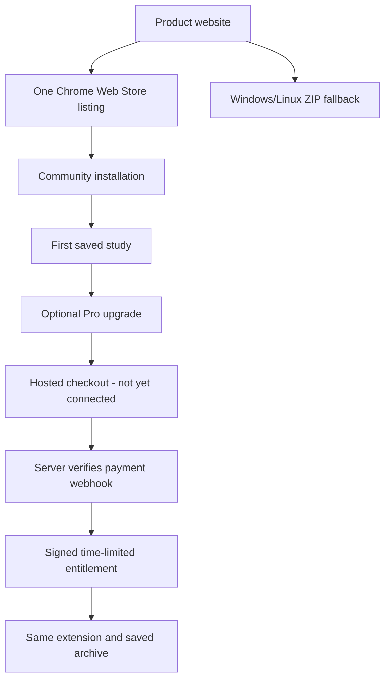

# Distribution and commercial launch

Prepared 26 September 2026. Status: local v0.20.0 candidate, not submitted to Chrome Web Store and not accepting payments.

## One extension, two editions

Use one Chrome Web Store item named **Backtest Vault**. Install Community for free; activate Pro in the same installation. Do not make customers install a second extension for paid features. One Store item preserves its own extension ID, archive and update channel across edition changes. Chrome on Windows and Linux is the first supported delivery target; broader Chromium browser support needs separate acceptance.

Chrome supports private testers, unlisted link distribution and public listings. **Unlisted is not private**: anyone with its Store URL can install it. All modes require Store review. Start with private trusted testers or a deliberately shareable unlisted pilot; switch the same item to public after acceptance. See [official distribution guidance](https://developer.chrome.com/docs/webstore/cws-dashboard-distribution).

## Files already prepared by the build

| Output | Purpose |
|---|---|
| `backtest-vault-0.20.0-store.zip` | Upload candidate: manifest at ZIP root, runtime assets, license notice; no installer, issuer secret or customer license |
| `backtest-vault-0.20.0.zip` | Existing complete Windows/Linux distribution with Setup/Update helpers, extension folder and checksums |
| `SHA256SUMS` / `SHA256SUMS-store` | Integrity checks for each candidate archive |

Build using `npm run package:store` and `npm run package:release`. A Store upload is **not** publication approval. No public listing, live purchase page or Store link exists yet.

Windows fallback retains Setup.cmd/Update.cmd; Linux retains setup.sh/update.sh. They use the existing installation model, with no administrator rights, permanent execution-policy change or end-user Node/Python dependency. Paid features use the same package. ZIP installs are a fallback and developer pilot channel; they retain manual update/reload friction, so the Store should become the normal customer route.

## Existing users need a migration, new users do not

An unpacked extension and a newly registered Store item can have different IDs and separate local storage. Do **not** promise automatic archive transfer to existing users.

1. In the old installed Vault, use Run library → Back up all. Retain the downloaded JSON.
2. Install the Store edition only after its real listing is available.
3. Import the backup into the Store edition and verify run/study counts and a report.
4. Re-activate the customer’s Pro license separately; licenses are deliberately excluded from research backups.
5. Keep the old extension and backup until verification succeeds. Then disable the old extension to avoid two capture overlays. Do not uninstall it before preserving its local archive.

Once on the Store item, future free-to-Pro upgrades use the same installation. Side-loading this candidate should update the existing unpacked folder, not silently install another copy.

## Launch sequence

1. **Owner acceptance:** inspect Community, activate evaluation, save/reuse a plan, inspect map evidence, export a report, verify expiry and backups. No new RZone stress tests are needed for features that only read saved records.
2. **Publisher setup:** owner-controlled developer account, final independent branding and support email, domain, privacy/support pages, legitimate icon/listing screenshots and reviewer access. Clearly state that a compatible signed-in RZone account is required for real backtests, Pro is optional, and Vault is independent of Definedge. Confirm commercial integration/branding expectations with Definedge before positioning a paid integration as supported.
3. **Small pilot:** 10–20 consenting RZone users, private/unlisted listing, explicit support window and feature scope. Any paid pilot uses agreed terms, a real invoice/payment process and manually issued expiring licenses. Do not pretend this candidate includes automated billing.
4. **Checkout implementation:** select the business entity and provider, then add hosted checkout, verified and idempotent webhooks, refund/cancellation handling, invoice/tax data and entitlement renewal. Test payment success, duplicate/delayed webhooks, failed renewal, cancellation, expiry, offline grace and charge reversal. Never unlock from a client-reported success URL.
5. **Public launch:** approved Store listing plus a product landing page. Publish clear free/Pro comparison, a short first-study video, support contact, final prices/taxes, cancellation and refund terms. Begin with relevant RZone communities and educational demos; no earnings promises, spam or unauthorized affiliate claims.

Google’s [publishing checklist](https://developer.chrome.com/docs/webstore/publish) calls for a publisher account, uploaded ZIP, listing/privacy/distribution information and reviewer test instructions. Review duration is not guaranteed. No Store submission or payment-provider account has been created by this work.

## Checkout architecture to implement after business details

Keep the research engine and records local. The minimal server stores customer/account identity, billing provider IDs, subscription state, entitlement dates and audit events. It should not receive strategy parameters, trade reports, symbol searches or market-data archives for license checks.

The server verifies the provider webhook signature, de-duplicates by event ID, reconciles the authoritative subscription/payment state and then issues a signed short-lived entitlement. Cancellation normally retains the already-paid period; refunds/reversals follow the published policy. A local grace policy must be explicit and bounded. Keep the issuer private key only in server secret storage. The current offline pilot cannot immediately revoke a file and does not implement this server.

The extension then needs an exact licensing API origin in its content security policy, a user-controlled account connection, signed entitlement refresh, clear network-failure handling and tests. No remote executable code or hosted scripts should be added. Update the privacy statement and Store disclosures before deploying that network-enabled build.

## Release gates still open

- Business name/domain, support contact and owner-controlled Store publisher access.
- Final billing provider, price/tax presentation, cancellation/refund terms and payment handling.
- Definedge integration/branding position; do not imply a partnership that does not exist.
- Long-term MIT/open-source versus new commercial/service licensing decision.
- Approved Store artwork, submission/review and migration acceptance.
- Real installed-extension acceptance of the new local research tools; the prior v0.19.0 RZone execution evidence remains the source-engine baseline.

These gates prevent charging or publishing prematurely. They do not block local Community/Pro implementation and evaluation.
