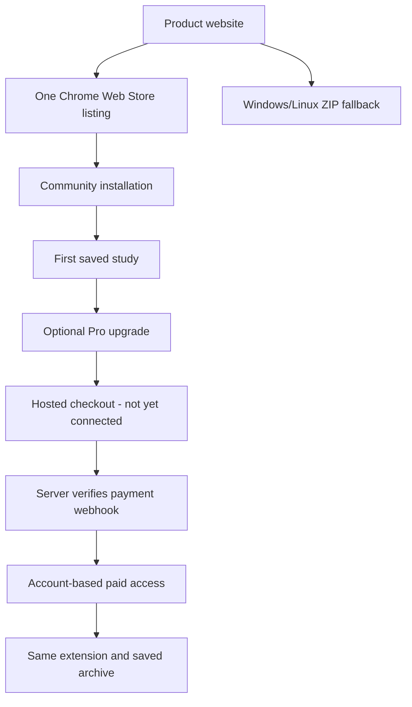

# Distribution and commercial launch

Updated 18 November 2026. Status: local v0.21.0 candidate with Store icons, staging deployment blueprint and launch checks. A public marketing preview is hosted at https://backtest-vault.pages.dev/ and clearly states that customer login/payments are pending. Supabase is hosted, restored and Healthy; account access remains closed. Not submitted to Chrome Web Store and not accepting payments. Shared login-limit changes are tested locally and still require deployment.

## One extension, two editions

Use one Chrome Web Store item named **Backtest Vault**. Install Community for free; activate Pro in the same installation. Do not make customers install a second extension for paid features. One Store item preserves its own extension ID, archive and update channel across edition changes. Chrome on Windows and Linux is the first supported delivery target; broader Chromium browser support needs separate acceptance.

Chrome supports private testers, unlisted link distribution and public listings. **Unlisted is not private**: anyone with its Store URL can install it. All modes require Store review. The selected launch channel is public, without an invited pilot. Complete deployment and acceptance checks before submitting the public item. See [official distribution guidance](https://developer.chrome.com/docs/webstore/cws-dashboard-distribution).

## Files already prepared by the build

| Output | Purpose |
|---|---|
| `backtest-vault-0.21.0-store.zip` | Upload candidate: manifest at ZIP root, runtime assets, license notice; no installer, issuer secret or customer license |
| `backtest-vault-0.21.0.zip` | Existing complete Windows/Linux distribution with Setup/Update helpers, extension folder and checksums |
| `SHA256SUMS` / `SHA256SUMS-store` | Integrity checks for each candidate archive |

Build using `npm run package:store` and `npm run package:release`. A Store upload is **not** publication approval. No public listing, live purchase page or Store link exists yet.

Windows fallback retains Setup.cmd/Update.cmd; Linux retains setup.sh/update.sh. They use the existing installation model, with no administrator rights, permanent execution-policy change or end-user Node/Python dependency. Paid features use the same package. ZIP installs are a fallback and developer pilot channel; they retain manual update/reload friction, so the Store should become the normal customer route.

## Existing users need a migration, new users do not

An unpacked extension and a newly registered Store item can have different IDs and separate local storage. Do **not** promise automatic archive transfer to existing users.

1. In the old installed Vault, use Run library → Back up all. Retain the downloaded JSON.
2. Install the Store edition only after its real listing is available.
3. Import the backup into the Store edition and verify run/study counts and a report.
4. Sign in with the same verified email to restore paid entitlement. Account tokens and billing receipts are deliberately excluded from research backups.
5. Keep the old extension and backup until verification succeeds. Then disable the old extension to avoid two capture overlays. Do not uninstall it before preserving its local archive.

Once on the Store item, future free-to-Pro upgrades use the same installation. Side-loading this candidate should update the existing unpacked folder, not silently install another copy.

## Launch sequence

1. **Owner acceptance:** verify email login, Community quota, ₹899/month subscription access, saved-settings reuse, maps/reports, cancellation, expiry and backups against the deployed services. No repeated RZone menu stress tests are needed for account changes.
2. **Publisher setup:** owner-controlled developer account, final independent branding and support email, domain, privacy/support pages, legitimate icon/listing screenshots and reviewer access. Clearly state that a compatible signed-in RZone account is required for real backtests, Pro is optional, and Vault is independent of Definedge. Confirm commercial integration/branding expectations with Definedge before positioning a paid integration as supported.
3. **Provider activation:** deploy the implemented Supabase/Razorpay account service, configure production email delivery and validate the fixed monthly plan. Complete merchant verification, webhook delivery and payment/refund acceptance using provider test mode before activating live keys.
4. **Store submission:** submit the public item with clear free/Pro disclosures, reviewer access and the required Windows/Linux packages. There is no invited pilot. Do not advertise paid access before checkout and renewal acceptance pass. Network failures block new runs and paid actions while preserving local read/export access; no unbounded offline paid grace is implemented.
5. **Public launch:** approved Store listing plus a product landing page. Publish clear free/Pro comparison, a short first-study video, support contact, final prices/taxes, cancellation and refund terms. Begin with relevant RZone communities and educational demos; no earnings promises, spam or unauthorized affiliate claims.

Google’s [publishing checklist](https://developer.chrome.com/docs/webstore/publish) calls for a publisher account, uploaded ZIP, listing/privacy/distribution information and reviewer test instructions. Review duration is not guaranteed. No Store submission or payment-provider account has been created by this work.

## Implemented account architecture

The v0.21.0 candidate includes Supabase email OTP, server-authoritative PostgreSQL quotas and Razorpay subscriptions at ₹899/month. Hosted checkout, verified invoices, signed notifications, refunds/expiry and cycle-end cancellation are implemented. Owner service accounts, deployment, email delivery and real provider acceptance remain pending. See [Accounts](ACCOUNTS.md) for configuration, validation scope and operational limits.

## Release gates still open

- Business name/domain, support contact and owner-controlled Store publisher access.
- Final billing provider, price/tax presentation, cancellation/refund terms and payment handling.
- Definedge integration/branding position; do not imply a partnership that does not exist.
- Long-term MIT/open-source versus new commercial/service licensing decision.
- Approved Store artwork, submission/review and migration acceptance.
- Real installed-extension acceptance of the new local research tools; the prior v0.19.0 RZone execution evidence remains the source-engine baseline.

These gates prevent charging or publishing prematurely. They do not block local Community/Pro implementation and evaluation. The owner has not yet decided the public operator name or support address. An owned sender domain/public email remains postponed under the existing zero-cost instruction. Do not publish invented business/contact details or purchase a domain without the owner's decision.

## Selected commercial model

Public launch, email-code login from the start, 50 successful automatic Community runs once per account, and ₹899/month Pro with continued automation and paid reuse/research tools. See [Accounts](ACCOUNTS.md) for the implementation and activation requirements. A closed account service and database are hosted, and an INR899/month Razorpay plan exists; those facts do not establish live email, billing or public distribution readiness.
