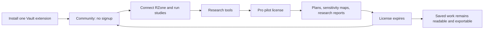

# Community and Pro — v0.20.0 candidate

This is a working local pilot, not a live subscription service. No checkout is enabled. Current installed v0.19.0 and its saved archive are not changed by building this candidate.

| Capability | Community | Pro pilot |
|---|---|---|
| Existing capture, local archive, backup and restore | Included | Included |
| Candle, P&F and Renko automation under the existing execution support rules | Included | Included |
| Existing setup fields, filters, inline test values and study automation | Included | Included |
| Existing comparisons, ranking, validation and holdout | Included | Included |
| Existing CSV/JSON exports and print views | Included | Included |
| Save named research plans with an explicit question and immutable versions | — | Included |
| Create a new draft from an exact saved research plan | — | Included |
| Sensitivity map with axes, slices, matched conditions and evidence links | — | Included |
| Generate research reports covering discovery, validation, holdout and excluded trials | — | Included |
| Read/restore/export previously saved research plans and read downloaded reports | Always | Always |

“Included” retains all existing source, chart, market, freshness and evidence checks. A paid license never authorizes an unsupported source operation or removes research exclusions. This is research software; no order execution is added.

## Customer journey



Open a study and choose **Research tools**. Choose **Community / Pro** in the header to see the editions and activate a signed license file. Research tools also opens from that panel, so saved plans remain accessible after their originating study is deleted. A research plan creates a **draft**; it does not send anything to RZone until the user starts it through the existing study controls. This first version reuses the exact plan; edit individual saved trials through the existing Use these settings journey when changing it.

Map cells use the current study’s decision rules. Different universes, timeframes, dates and portfolio assumptions stay in separate matched groups. Additional dimensions are held at an explicit selected slice. Cells do not average multiple trials. Missing results are blank; exclusions link back to evidence. Colours describe observed results and do not establish statistical robustness. Reports retain source run identifiers, settings, eligible and excluded results, and separate research stages. Reports download as standalone HTML; PDF uses the browser’s Print command.

## Pilot activation and limits

- ECDSA P-256 signed license files; public verification keys only in the extension.
- A license activates the three new research features until its expiry date. Invalid or expired files fall back to Community; existing records are not deleted or rewritten.
- Issuer keys stay outside the repository, Store package and installer. The issuer CLI refuses initialization inside the repository and refuses overwriting an existing key or license output.
- This is offline pilot licensing, not tamper-proof DRM: device-clock changes, modified source builds, license sharing and immediate remote revocation are not controlled. There is no device binding, paid seat management or automatic renewal. Do not sell it as those services.
- The repository’s existing MIT terms remain unchanged. These terms permit forks and modifications. Selling supported releases and service is possible, but client feature gates do not create exclusive rights to MIT code. Agree on the long-term source/service model before publishing paid modules or accepting broad subscription commitments; obtain qualified advice for any licensing changes. Previously granted rights remain intact.
- No account or billing backend has been invented. Checkout, receipts, cancellations, refunds, tax treatment and entitlement renewal must be connected and tested before public paid launch.

The proposed public price remains **₹499/month or ₹4,999/year**, subject to validation and a clear final tax-inclusive checkout. These are proposed prices, not an active offer or recurring-charge authorization. Do not charge customers until the commercial and support details are finalized.

## Developer and issuer operations

Run `npm run test:editions` for the new feature suites and `npm run test:unit` for existing regressions. `npm run check` verifies syntax, packaged assets, installer parity and unchanged extension permissions.

```text
node scripts/issue-license.cjs --init <PRIVATE_DIRECTORY_OUTSIDE_REPO>
```

Copy only that directory’s `license-keys.js` public file to `dist/license-keys.js` for a new issuer. Retain earlier public keys when rotating keys so valid pilot licenses keep working. Keep the private key in restricted, backed-up operator storage; do not send it to customers or commit it.

```text
node scripts/issue-license.cjs --key <PRIVATE_KEY_FILE> --to <RECIPIENT_LABEL> --days 30 --output <NEW_LICENSE_FILE>
```

Use `--evaluation` for a non-paid evaluation. The recipient activates the JSON file through the edition panel. A license is a bearer file: transfer it privately to that recipient. Issuing a license is not evidence that a payment was made.

`scripts/preview-editions.cjs --license <SIGNED_EVALUATION_FILE>` provides an isolated fictional preview. It verifies the real signature; it has no free `pro=true` unlock. The preview harness is excluded from runtime ZIPs and never accesses RZone or durable user research.
